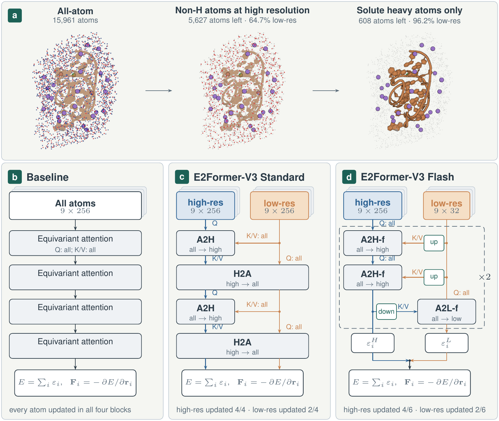
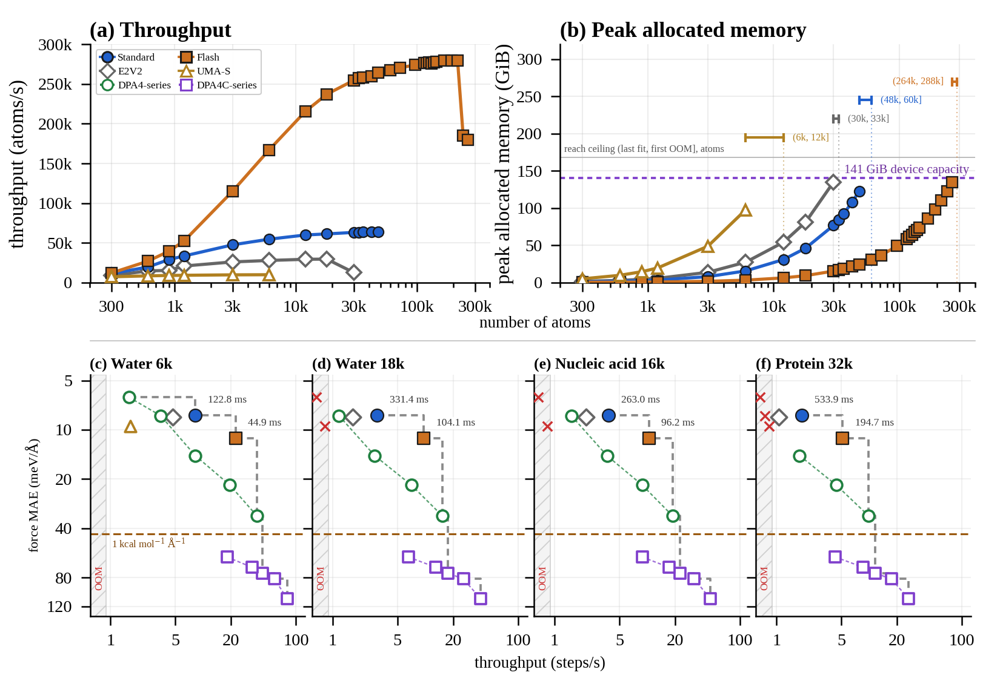

# UBio-MolFM: Universal Bio-Molecular Foundation Model

> **Note**: This is the latest repository of **UBio-MolFM**, which also includes code and research from previous versions. 
> - **E2Former-LSR**: Scalable Machine Learning Force Fields through Long-Range Aware Message Passing ([arXiv:2601.03774](https://arxiv.org/abs/2601.03774) | [Code Release: E2Former-LSR](https://github.com/IQuestLab/UBio-MolFM/releases/tag/E2Former-LSR))
> - **E2Former-V2**: On-the-Fly Equivariant Attention with Linear Activation Memory ([arXiv:2601.16622](https://arxiv.org/abs/2601.16622) | [Code Release: E2Former-V2](https://github.com/IQuestLab/UBio-MolFM/releases/tag/E2Former-V2))
> - **UBio-MolFM-V1**: Universal Molecular Foundation Model for Bio-Systems ([arXiv:2602.17709](https://arxiv.org/abs/2602.17709))
> - **UBio-MolFM-V1.5**: Enabling Biomolecular Dynamics at DFT Accuracy and 10⁵ Atoms with One Untuned Potential ([arXiv:2608.18623](https://arxiv.org/abs/2608.18623)) | Current repository

UBio-MolFM is a foundation model suite for molecular modeling, developed by the UBio-MolFM team. This repository provides the implementation of UBio-MolFM models, including the **E2Former-V2** and **E2Former-V3** backbones, together with tools for training, inference, and molecular dynamics (MD) simulation.

## Table of Contents

- [What's New in E2Former-V3](#whats-new-in-e2former-v3)
  - [OMol25 accuracy (Table 2)](#omol25-accuracy-table-2)
  - [Efficiency](#efficiency)
- [Quick Configuration](#quick-configuration)
- [Quick Use of Pretrained Models](#quick-use-of-pretrained-models)
  - [The Inference Configuration File](#the-inference-configuration-file)
  - [Example 1: Single-Point Energy and Force Prediction](#example-1-single-point-energy-and-force-prediction)
  - [Example 2: Molecular Dynamics with ASE](#example-2-molecular-dynamics-with-ase)
  - [Example 3: Command-Line Simulations](#example-3-command-line-simulations)
  - [Standard / Flash](#standard--flash)
  - [Performance Notes](#performance-notes)
  - [Mixed-resolution configuration](#mixed-resolution-configuration)
- [Training](#training)
  - [Data Preparation](#data-preparation)
  - [Launching Training](#launching-training)
  - [Training Standard / Flash](#training-standard--flash)
- [Related Work](#related-work)
- [Citation](#citation)
- [License](#license)

## What's New in E2Former-V3

E2Former-V3 is an **atom-role-aware** equivariant potential. Instead of giving every atom the
same latent width and the same number of block updates, a static chemical role is assigned
before the backbone runs and sets both the atom's **latent width** and **how many block
updates** it receives. Every atom stays in the graph, every force is still the gradient of one
conservative energy, and no coordinate is integrated out — only the capacity an atom consumes
changes. The architecture is released in this repository as the mixed-resolution backbone
behind the **Standard / Flash** configurations described below.



*Figure 1: E2Former-V3 under three capacity allocations on one 15,961-atom solvated nucleic
acid — (a) every atom high-resolution, (b) the uniform baseline, (c) **Standard**
(`[A2H, H2A]×2`, one shared 256-channel state, 2/4 updates), and (d) **Flash**
(`[A2H-f, A2H-f, A2L-f]×2`, two persistent streams at 256 vs. 32 channels per degree,
2/6 and 4/6 updates). Role heads merge before forces are differentiated, so no atom is removed
and no coordinate is integrated out.*

| Configuration | What changes | OMol25 force MAE (meV/Å) | Throughput vs. E2Former-V2 |
| --- | --- | --- | --- |
| **E2Former-V3-Standard** | Hydrogens go through half as many full-width block updates | **8.146** (E2Former-V2: 8.38) | **1.75–1.84×** |
| **E2Former-V3-Flash** | Hydrogens and water oxygens go through a narrow stream with fewer updates | 11.272 (+3.126) | **4.00–5.85×** |

Both configurations are non-dominated on every accuracy–throughput frontier. On one datacenter GPU,
single-step evaluation completes 30k atoms for E2Former-V2, 48k for Standard, and 264k for
Flash; the largest MD system in the study is a 32,437-atom solvated protein. The
physical-validation campaign completes all 54 production MD legs (water, 150 mM salt and a
solvated peptide; 20 ps, three ensembles × three seeds), a 100 ps NVE campaign, and a 1 ns NVT
run on the protein. An inference-only reachable-row optimization adds no parameters and cuts
Flash latency by 23.1–25.5%.

### OMol25 accuracy (Table 2)

Energy MAE (E, meV/atom) and per-component force MAE (F, meV/Å) on the full 2,762,021-sample
OMol25 composition validation split. Best per column in **bold**, second best in *italics*.
Standard/Flash results are conservative; external baselines are as published.

| Model | Biomolecules (E / F) | Electrolytes (E / F) | Metals (E / F) | Organics (E / F) | Total (E / F) |
| --- | --- | --- | --- | --- | --- |
| eSEN-sm-cons | 0.59 / **4.61** | **1.01** / *8.08* | 2.30 / 28.86 | **0.84** / **11.11** | *1.27* / *8.25* |
| UMA-S | **0.53** / 5.69 | 2.69 / 11.65 | 4.63 / 37.85 | *1.00* / *13.15* | 3.62 / 12.02 |
| MACE-OMOL | 1.76 / 6.05 | 2.15 / 10.87 | **2.15** / *24.51* | 2.31 / 23.70 | 1.84 / 10.10 |
| E2Former-V2-Cons. | 1.01 / *4.96* | *1.52* / 10.11 | *2.18* / **24.40** | 1.26 / 19.69 | **1.16** / 8.38 |
| **E2Former-V3-Standard** | 2.01 / 5.10 | 2.27 / **8.00** | 2.47 / 25.56 | 1.89 / 17.07 | 2.19 / **8.15** |
| **E2Former-V3-Flash** | 5.00 / 7.68 | 3.92 / 11.45 | 2.86 / 28.40 | 2.45 / 20.07 | 3.94 / 11.27 |

**Trade-off, not a uniform win.** Standard is worse than E2Former-V2 on biomolecules
(5.10 vs. 4.96) and metals (25.56 vs. 24.40), better on electrolytes (8.00 vs. 10.11) and
organics (17.07 vs. 19.69); Flash is worse on all four domains. Flash's reduced water path
also reproduces only 49.7% of the DFT water-dimer repulsion wall at 1.80 Å — a short-range
softening that averaged force error and the radial distribution function do not reveal.

### Efficiency



*Figure 2: Efficiency under device-specific protocols. (a, b) datacenter-GPU water-box ladder —
single-step throughput and peak allocated memory, with the exact cell-list backend for Flash
and Standard; red crosses mark OOM. (c–f) Force MAE on the OMol25 composition validation split
against datacenter-GPU throughput across benchmark systems, with the empirical Pareto frontier dashed.
Panels (a, b) and (c–f) are separate campaigns and are not pooled.*

## Quick Configuration

The project targets Python 3.12 and PyTorch 2.8.0 with CUDA 12.8. We recommend `mamba` or `conda` for environment management. The PyG extension wheels and `faiss-gpu` are built against a specific torch/CUDA pair, so keep those pins together if you change them.

```bash
# Create the environment
mamba env create -f install/environment_py312.yaml

# Activate the environment
conda activate mfm
```

`fairchem-core` is required by the Standard/Flash configurations: their
`ffn_type: s2` FFN imports `fairchem.core.models.uma` through
`molfm.models.e2former.uma_utils`. It is not part of the conda env's pip list
because its torch pin conflicts with the pinned torch; install it after
creating the environment:

```bash
pip install --no-deps fairchem-core==2.4.0
```

The `s3`/`swiglu` FFNs do not need it.

Repository layout at a glance:

| Path | Description |
| --- | --- |
| `config_file/` | Model and training configurations in YAML format. |
| `src/molfm/models/` | Molecular backbone implementations, including `e2former`. |
| `src/molfm/interface/` | Integration layers for ASE and other external tools, including the `cli.py` simulation entry point and the GPU-native `torch_ext/` MD stack. |
| `src/molfm/pipeline/` | Training and validation orchestration. |
| `src/molfm/tasks/` | Task-specific entry points, such as pretraining and inference. |
| `src/molfm/scripts/` | Shell scripts for common training stages, including OC20, SPICE, and Omol25. |
| `tools/samples/` | Example input structures for the CLI, e.g. `water216_nvt.xyz`. |

## Quick Use of Pretrained Models

Pretrained checkpoints and high-precision datasets are available on Hugging Face:

- [IQuest-UBio-MolFM-V1.5](https://huggingface.co/IQuestLab/IQuest-UBio-MolFM-V1.5): Pretrained checkpoints (current release).
- [IQuest-UBio-MolFM-V1](https://huggingface.co/IQuestLab/IQuest-UBio-MolFM-V1): Pretrained checkpoints of the previous release.
- [UBio-Protein26](https://huggingface.co/datasets/IQuestLab/UBio-Protein26): 5 million high-precision protein DFT dataset (a subset of UBio-Mol26).
- [UBio-MolFM V1.5 Technical Report](https://arxiv.org/abs/2608.18623): Methods, benchmarks, and the MD validation campaigns for the current release.

Use the downloaded checkpoint together with its matching configuration file. By default, the inference interface resolves the configuration from the checkpoint directory when `config_name` is not an absolute path.

This pretrained checkpoint is built on the UBio-MolFM framework, trained with the **UBio-Mol26** (19M) bio-specific dataset + OMol25, the E2Former-V2 linear-scaling equivariant transformer, and a three-stage curriculum learning strategy. It has been evaluated for accuracy on high-fidelity DFT datasets at the 1,500-atom scale, and it can support single-GPU simulations of up to approximately 100,000 atoms, depending on available device memory.

### The Inference Configuration File

Training and inference read configuration differently, and the distinction matters when you pass `--config` / `config_name` by hand:

- **Training** goes through Hydra. `config_file/config_molfm.yaml` is a *composition root*: its first entry is a `defaults:` list that pulls in `backbone_config/e2former.yaml`, `strategy_config/`, `scheduler_config/`, and so on.
- **Inference** (`E2FormerCalculator`, `E2FormerModelInterface`, `interface/ase/cli.py`) loads a single **flattened** yaml — one file with the composition already resolved. Passing the Hydra root to it fails with `TypeError: SmallMolConfig.__init__() got an unexpected keyword argument 'defaults'`.

Checkpoints on Hugging Face ship with their own flattened config next to the weights, which is why the interface resolves the config from the checkpoint directory by default. Point `--config` at that file (or at its directory) and there is nothing else to do.

For a model you trained yourself — or to smoke-test the plumbing with `--checkpoint none` (randomly initialized weights) — a flattened config is just the backbone block plus a few top-level keys. Every other field falls back to its default in `SmallMolConfig`:

```yaml
# config_inference.yaml — minimal flattened config for the E2Former-V2 backbone
backbone: e2former
# Must contain the head you pass as --head_name / head_name=; the energy and force
# heads are built from this list, so an empty value leaves the model with no heads.
dataset_name_list: omol25
AutoGradForce: true

# Same content as config_file/backbone_config/e2former.yaml, nested one level down.
backbone_config:
  name: e2former
  encoder_embed_dim: 1024
  ffn_embedding_dim: 1536
  num_attention_heads: 32
  dropout: 0.1
  num_encoder_layers: 12
  pbc_expanded_token_cutoff: 256
  pbc_expanded_num_cell_per_direction: 4
  num_layers: 4
  irreps_node_embedding: "256x0e+256x1e+256x2e"
  irreps_head: "2x0e+2x1e+2x2e"
  attn_scalar_head: 8
  num_attn_heads: 128
  number_of_basis: 256
  max_radius: 4.5
  max_neighbors: 32
  alpha_drop: 0
  basis_type: gaussiansmear
  norm_layer: rms_norm_sh
  attn_type: so2-first-order
  tp_type: QK_alpha+triton
  edge_embedtype: default
  ffn_type: s3
  encoder: default
  with_cluster: false
```

The backbone block must match the checkpoint's architecture exactly — `load_state_dict` runs with `strict=False`, so a mismatch silently leaves parameters randomly initialized instead of raising. To flatten the exact configuration a training run used, let Hydra resolve it:

```python
import sys, yaml
sys.path.insert(0, "src")
import molfm.tasks.pretrain_smallmol  # registers the config schema
from hydra import compose, initialize_config_dir
from omegaconf import OmegaConf

with initialize_config_dir(config_dir="/abs/path/to/config_file", version_base=None):
    cfg = compose(config_name="config_molfm", overrides=["dataset_name_list=omol25"])

yaml.safe_dump(OmegaConf.to_container(cfg, resolve=True), open("config_inference.yaml", "w"))
```

### Example 1: Single-Point Energy and Force Prediction

```python
from ase.build import molecule
from molfm.interface.ase.calculator.e2former_calculator import E2FormerCalculator

atoms = molecule("H2O")
atoms.set_cell([10, 10, 10])
atoms.pbc = [True, True, True]

calc = E2FormerCalculator(
    checkpoint_path="path/to/checkpoint.pt",
    config_name="config_molfm.yaml",
    head_name="omol25",
    device="cuda",
    use_tf32=True,
    use_compile=True,
)

atoms.calc = calc
energy = atoms.get_potential_energy()
forces = atoms.get_forces()

print(f"Energy: {energy} eV")
print(f"Forces:\n{forces}")
```

### Example 2: Molecular Dynamics with ASE

```python
from ase import units
from ase.md.langevin import Langevin
from ase.md.velocitydistribution import MaxwellBoltzmannDistribution

MaxwellBoltzmannDistribution(atoms, temperature_K=300)
dyn = Langevin(atoms, 1 * units.fs, temperature_K=300, friction=0.01)
dyn.run(100)
```

### Example 3: Command-Line Simulations

For relaxation and MD you normally do not need to write Python at all. `src/molfm/interface/ase/cli.py` is a [Fire](https://github.com/google/python-fire)-based entry point over the GPU-native simulation stack in `src/molfm/interface/ase/torch_ext/`, where positions, velocities, forces and the integrator all stay on the GPU for the whole trajectory (no per-step host round-trip). Trajectories are written to HDF5 by a background writer, and runs resume from the last saved frame automatically.

A ready-to-run example ships with the repository: `tools/samples/water216_nvt.xyz` is a periodic box of 216 water molecules (648 atoms, 18.64 Å cell). The command below downloads the pretrained checkpoint from Hugging Face and runs 100 ps of NVT dynamics at 300 K with a 0.5 fs timestep:

```bash
# Fetch the checkpoint and its flattened config (molfm-v1p5-stage-3.pt + config.yaml)
hf download IQuestLab/IQuest-UBio-MolFM-V1.5 molfm-v1p5-stage-3.pt config.yaml \
    --local-dir ckpt/molfm-v1p5

# 216-water box, 100 ps NVT (200,000 x 0.5 fs) at 300 K
python src/molfm/interface/ase/cli.py \
    --input_path tools/samples/water216_nvt.xyz \
    --checkpoint ckpt/molfm-v1p5/molfm-v1p5-stage-3.pt \
    --config ckpt/molfm-v1p5/config.yaml \
    --head_name omol25 \
    --task md --steps 200000 --temp 300 --dt 0.5 --ensemble nvt \
    --global_sync_interval 10 --log_interval 500 --seed 42 \
    --use_tf32 True --use_compile True --save_in_fp32 True \
    --device cuda:0 --work_dir runs --name water216_nvt_100ps
```

```bash
# List every option
python src/molfm/interface/ase/cli.py --help

# Single-point-style: relax a structure (L-BFGS) and stop
python src/molfm/interface/ase/cli.py \
    --input_path system.xyz \
    --checkpoint path/to/checkpoint.pt \
    --config path/to/config.yaml \
    --head_name omol25 \
    --task relax --relax_steps 200 --fmax 0.05 \
    --work_dir runs --name my_job

# NVT molecular dynamics (Langevin), 100 ps at 300 K with a 0.5 fs step
python src/molfm/interface/ase/cli.py \
    --input_path system.pdb \
    --checkpoint path/to/checkpoint.pt \
    --config path/to/config.yaml \
    --head_name omol25 \
    --task md --steps 200000 --temp 300 --dt 0.5 \
    --global_sync_interval 100 --log_interval 100 \
    --use_tf32 True --use_compile True \
    --work_dir runs --name my_job

# Constant pressure (energy-only Monte-Carlo barostat)
python src/molfm/interface/ase/cli.py ... \
    --ensemble npt --pressure_bar 1.0 --barostat_interval 50

# Large system: keep 30% of activations, recompute the rest in the backward pass
python src/molfm/interface/ase/cli.py ... \
    --use_compile True --recompute 0.3
```

Key options:

| Flag | Meaning |
| --- | --- |
| `--task` | `relax`, `md`, or `both` (relax, then MD from the relaxed structure). |
| `--input_path` | `.xyz`, `.pdb` or `.gro`. Alternatively pass `--pos` / `--numbers` / `--cell` as literals or `.npy` paths. |
| `--config` | Path to the config yaml, or to the directory containing it. Defaults to the checkpoint's directory. |
| `--ensemble` | `nvt` (default), `npt` (MC barostat), or `nve` (deterministic velocity-Verlet). |
| `--thermostat` | `langevin` (default) or `qtb` for a Quantum Thermal Bath (nuclear quantum effects). |
| `--global_sync_interval` | Steps between trajectory writes. |
| `--resume` / `--resume_step` | Continue from the last saved frame, optionally truncating to a given step first. On by default. |
| `--recompute` | Activation-memory budget in `[0, 1]` for `torch.compile`; lower trades compute for memory. |
| `--barostat_mode` | NPT box coupling: `isotropic` (default) scales all three axes; `semiiso` couples the two in-plane axes and the out-of-plane axis separately (use with `--barostat_dlnV_z`). |
| `--barostat_interval` / `--barostat_dlnV` / `--barostat_dlnV_z` | MC-barostat attempt interval, isotropic volume move size, and (semiiso only) thickness move size. |
| `--lf_o_in_hoh` | Route water oxygens through the mixed-resolution LIGHT stream. Set only for checkpoints trained with `lf_O_in_HOH=True`. |
| `--hoh_o_fudge_factor` | Bond-detection scale used by `--lf_o_in_hoh` when the input has no residue names (default `0.55`). |

Trajectories land in `<work_dir>/<name>_relax.h5` and `<work_dir>/<name>_md.h5`. Because `--resume` is on by default, re-running the same `--work_dir`/`--name` continues the existing trajectory and ignores the geometry input — the input is still read to check that it describes the same system (same atomic numbers), and the run aborts rather than silently extending a different system's trajectory. Use a fresh `--name` or `--resume False` to start over.

Trajectories can be read back with `H5Trajectory`:

```python
from molfm.interface.ase.torch_ext.h5_trajectory import H5Trajectory

frame = H5Trajectory.read_last_frame("runs/my_job_md.h5")
print(frame["n_frames"], frame["steps"], frame["positions"].shape)
```

### Standard / Flash

The mixed-resolution backbone is released as two configurations, each distributed as a checkpoint plus its flattened inference config:

| Variant | Checkpoint | Config | Depth | Cutoff | Cross-stream schedule |
| --- | --- | --- | --- | --- | --- |
| Standard | `standard/molfm-v2-standard-stage3.pt` | `standard/config.yaml` | 6 | 5.5 Å | `interleaved` |
| Flash | `flash/molfm-v2-flash-stage3.pt` | `flash/config.yaml` | 6 | 5.0 Å | `interleaved_flash` |

Minimal flattened inference configs are provided at
`config_file/examples/standard.yaml` and `config_file/examples/flash.yaml`;
the matching Hydra backbone configs are
`config_file/backbone_config/standard.yaml` and `flash.yaml`.

The example configs follow the training recipes (Standard `max_radius=6`,
Flash `5.5`). Released checkpoints may carry a different cutoff; use the config
shipped with the checkpoint for those.

```bash
# Standard
hf download IQuestLab/IQuest-UBio-MolFM-V2 --include "standard/*" --local-dir ckpt/standard

# Flash
hf download IQuestLab/IQuest-UBio-MolFM-V2 --include "flash/*" --local-dir ckpt/flash
```

The same 216-water NVT example with each variant (single GPU):

```bash
# Standard
python src/molfm/interface/ase/cli.py \
    --input_path tools/samples/water216_nvt.xyz \
    --checkpoint ckpt/standard/standard/molfm-v2-standard-stage3.pt \
    --config ckpt/standard/standard/config.yaml \
    --head_name omol25 \
    --task md --steps 200000 --temp 300 --dt 0.5 --ensemble nvt \
    --global_sync_interval 10 --log_interval 500 --seed 42 \
    --use_tf32 True --use_compile True --recompute 0.3 \
    --device cuda:0 --work_dir runs --name water216_nvt_100ps_v2_standard

# Flash
python src/molfm/interface/ase/cli.py \
    --input_path tools/samples/water216_nvt.xyz \
    --checkpoint ckpt/flash/flash/molfm-v2-flash-stage3.pt \
    --config ckpt/flash/flash/config.yaml \
    --head_name omol25 \
    --task md --steps 200000 --temp 300 --dt 0.5 --ensemble nvt \
    --global_sync_interval 10 --log_interval 500 --seed 42 \
    --use_tf32 True --use_compile True --recompute 0.3 \
    --device cuda:0 --work_dir runs --name water216_nvt_100ps_v2_flash
```

> **Note**: The `standard/` and `flash/` checkpoints are placeholders until the real weights are uploaded.

### Performance Notes

- `use_tf32=True` enables TensorFloat-32 on supported NVIDIA GPUs. It typically improves throughput, but it may introduce a small loss in numerical precision.
- `use_compile=True` enables `torch.compile`. It typically improves execution speed and may reduce memory usage in some workloads.
- `--recompute` (0.0–1.0, `torch.compile` only) caps the fraction of activations kept in memory and recomputes the rest, which is how the largest systems are made to fit. It has no effect when `--use_compile False` or when the model uses a direct force head (`AutoGradForce=False`), because there is no activation graph to trade.
- The first run may take longer because the backend needs to initialize kernels and compilation artifacts.

### Mixed-resolution configuration

Standard and Flash are `e2former` backbones with the `mixed_resolution`
block enabled in their config yaml. The keys that matter at inference time:

```yaml
backbone_config:
  name: e2former
  mixed_resolution:
    enabled: true
    cross_mode: "interleaved"        # "interleaved" (Standard) | "interleaved_flash" (Flash)
    # cross_mode_list: one token per block. Use the list shipped in the
    # checkpoint's config.yaml; Standard tokens are A2H / A2A / H2A / A2L and
    # Flash tokens are A2H-flash / A2L-flash.
    lf_atoms: [1]                    # atomic numbers routed to the light stream (H)
    irreps_light_embedding: "32x0e"  # light-stream width and maximum order
    energy_head: "distinct"          # required by interleaved_flash; "standard" or
                                     # "distinct" under interleaved
```

`cross_mode` selects the two-stream layout, while `cross_mode_list` fixes the
per-block schedule and must have one entry per block. A config must match the
schedule the checkpoint was trained with; the released `standard/config.yaml`
and `flash/config.yaml` already do.

## Training

UBio-MolFM training is launched with `torchrun`. Example scripts are available under `src/molfm/scripts/`.

### Data Preparation

UBio-MolFM supports three data entry modes:

- **LMDB datasets**: the loader recursively scans a directory for `.lmdb` or `.aselmdb` files.
- **SPICE xyz files**: set `dataset_name_list=spice` and point `data_path_list` and `data_path_list_valid` to `.xyz` files.

The training scripts interpret `data_path_list` and `data_path_list_valid` relative to `data_path`. The shipped shell scripts use the repository `data/` directory as the root by default.

Recommended layout:

```text
data/
  omol25/
    train/
    val_1M/
  SPICE/
    train_large_neut_no_bad_clean.xyz
    test_large_neut_all.xyz
  OC20/
    s2ef/
      2M/train/
      all/val_id/
```

Example configurations:

```bash
# Omol25
data_path=./data
data_path_list=omol25/train
data_path_list_valid=omol25/val_1M
dataset_name_list=omol25

# SPICE
data_path=./data
data_path_list=SPICE/train_large_neut_no_bad_clean.xyz
data_path_list_valid=SPICE/test_large_neut_all.xyz
dataset_name_list=spice

# OC20
data_path=./data
data_path_list=OC20/s2ef/2M/train
data_path_list_valid=OC20/s2ef/all/val_id
dataset_name_list=oc20
```

If `data_path_list_valid` is omitted for an LMDB dataset, UBio-MolFM falls back to the `train_val_test_split` defined in the configuration file, which defaults to `0.95 / 0.05 / 0.0`.

### Launching Training

Example: pretraining on Omol25

```bash
bash src/molfm/scripts/omol25/pretrain_e2former_v2_stage1.sh
```

Equivalent `torchrun` entry point:

```bash
torchrun --nproc_per_node 8 src/molfm/tasks/pretrain_smallmol.py \
    --config-name=config_molfm.yaml \
    backbone=e2former \
    backbone_config=e2former \
    strategy_config=ddp \
    save_dir=./outputs/ckpt_log/
```

For training, the most frequently tuned options are:

- `save_dir`: output directory for checkpoints and logs.
- `dataset_micro_batch_size`: per-device micro-batch size.
- `gradient_accumulation_steps`: effective batch size scaling.
- `use_tf32`: enable TensorFloat-32 for faster execution on supported GPUs.
- `use_compile`: enable `torch.compile` for faster execution and possible memory savings.

### Training Standard / Flash

Two-stage recipes based on the OMol25 runs are provided under
`src/molfm/scripts/omol25/`. Stage 1 trains with a direct force head
(`AutoGradForce=False`); stage 2 fine-tunes with autograd forces
(`AutoGradForce=True`) from the stage-1 checkpoint.

```bash
# Standard (4 TransBlocks, max_radius=6, interleaved routing)
bash src/molfm/scripts/omol25/pretrain_e2former_v3_standard_stage1.sh
ckpt_path=/path/to/standard_stage1/checkpoint.pt \
    bash src/molfm/scripts/omol25/pretrain_e2former_v3_standard_stage2.sh

# Flash (6 TransBlocks, max_radius=5.5, interleaved_flash, HOH water-O light)
bash src/molfm/scripts/omol25/pretrain_e2former_v3_flash_stage1.sh
ckpt_path=/path/to/flash_stage1/checkpoint.pt \
    bash src/molfm/scripts/omol25/pretrain_e2former_v3_flash_stage2.sh
```

The data root defaults to `${PROJECT_ROOT}/data/omol25` (`DATA_ROOT` overrides
it; point it at a directory containing `train/` and `val_1M/`). The scripts read
`data_path_list`, `dataset_micro_batch_size`, `n_gpu`, `num_workers`,
`total_num_steps` and `save_dir` from the environment, so a run can be shortened
or relocated without editing the file. `ckpt_path` is required for stage 2 and
is loaded with `ifresume=model_state_unstrict` (model weights only, fresh
optimizer).

The `config_file/backbone_config/standard.yaml` and `flash.yaml` files describe
the training/inference architecture (Standard `max_radius=6`, Flash `5.5`).
Released checkpoints may ship a different cutoff, so use the config shipped with
the checkpoint when running released weights.

## Related Work

For more details on the methodology and architecture, see the associated papers:

- **UBio-MolFM: Enabling Biomolecular Dynamics at DFT Accuracy and 10⁵ Atoms with One Untuned Potential** (2026): [arXiv:2608.18623](https://arxiv.org/abs/2608.18623)
- **UBio-MolFM: A Universal Molecular Foundation Model for Bio-Systems** (2026): [arXiv:2602.17709](https://arxiv.org/abs/2602.17709)
- **E2Former-V2: On-the-Fly Equivariant Attention with Linear Activation Memory** (2026): [arXiv:2601.16622](https://arxiv.org/abs/2601.16622)
- **Scalable Machine Learning Force Fields for Macromolecular Systems Through Long-Range Aware Message Passing (E2Former-LSR)** (2026): [arXiv:2601.03774](https://arxiv.org/abs/2601.03774)
- **E2Former: An Efficient and Equivariant Transformer with Linear-Scaling Tensor Products** (2025): [arXiv:2501.19216](https://arxiv.org/abs/2501.19216)

## Citation

The `Related Work` section lists the main papers and release references, while this section provides the recommended citation format for academic use.

If you use UBio-MolFM or E2Former-V2 in your research, please cite the following:

```bibtex
@techreport{huang2026ubiomolfm1p5,
      title={UBio-MolFM: Enabling Biomolecular Dynamics at DFT Accuracy and 10^5 Atoms with One Untuned Potential}, 
      author={Lin Huang and Frank Peng and JiaJun Cheng and Zion Wang and Hao Yin and Hao Li and Ji Zhang and Jack Jia and Junping Zhao and Arthur Jiang and Jia Zhang},
      institution={IQuest Research, UBio Team},
      year={2026},
      note={Technical report},
      url={https://arxiv.org/abs/2608.18623},
}

@misc{huang2026ubiomolfm,
      title={UBio-MolFM: A Universal Molecular Foundation Model for Bio-Systems}, 
      author={Lin Huang and Arthur Jiang and XiaoLi Liu and Zion Wang and Jason Zhao and Chu Wang and HaoCheng Lu and ChengXiang Huang and JiaJun Cheng and YiYue Du and Jia Zhang},
      year={2026},
      eprint={2602.17709},
      archivePrefix={arXiv},
      primaryClass={physics.chem-ph}
}

@misc{huang2026e2formerv2,
      title={E2Former-V2: On-the-Fly Equivariant Attention with Linear Activation Memory}, 
      author={Lin Huang and Chengxiang Huang and Ziang Wang and Yiyue Du and Chu Wang and Haocheng Lu and Yunyang Li and Xiaoli Liu and Arthur Jiang and Jia Zhang},
      year={2026},
      eprint={2601.16622},
      archivePrefix={arXiv},
      primaryClass={cs.LG}
}

@misc{wang2026scalable,
      title={Scalable Machine Learning Force Fields for Macromolecular Systems Through Long-Range Aware Message Passing}, 
      author={Chu Wang and Lin Huang and Xinran Wei and Tao Qin and Arthur Jiang and Lixue Cheng and Jia Zhang},
      year={2026},
      eprint={2601.03774},
      archivePrefix={arXiv},
      primaryClass={physics.chem-ph}
}

@misc{li2025e2former,
      title={E2Former: An Efficient and Equivariant Transformer with Linear-Scaling Tensor Products}, 
      author={Yunyang Li and Lin Huang and Zhihao Ding and Chu Wang and Xinran Wei and Han Yang and Zun Wang and Chang Liu and Yu Shi and Peiran Jin and Tao Qin and Mark Gerstein and Jia Zhang},
      year={2025},
      eprint={2501.19216},
      archivePrefix={arXiv},
      primaryClass={cs.LG}
}
```

## License

This repository is released under the MIT License.
